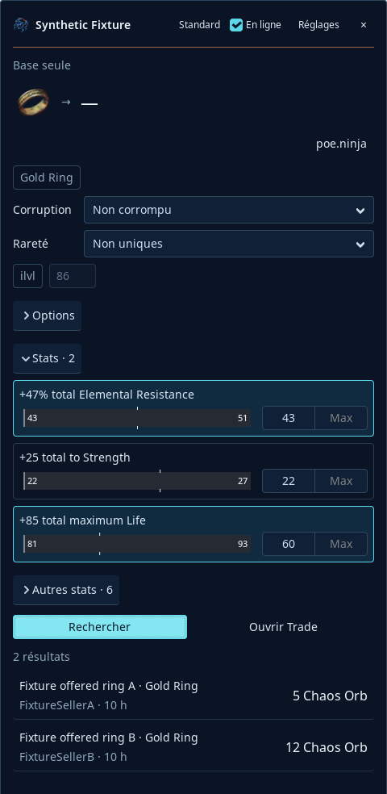
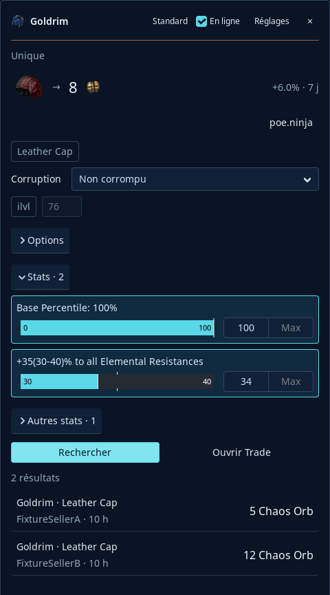

# Awakened Crab Trade

A native Path of Exile 1 price checker for Linux and Windows, inspired by
Awakened PoE Trade.

- Select item modifiers and adjust integer Min/Max filters.
- Search Trade offers and hover over a result to see its full mods and price.
- Check poe.ninja prices for currency, gems, uniques, maps and Viscera.
- Use a full-height overlay beside the inventory, with automatic league selection.
- Dark navy and cyan styling inspired by the crab icon.

## Screenshots

Cropped demo views from version 0.31.1. Click for full panels. Offers and prices are test data.

| Gem | Rare | Unique | Currency |
| --- | --- | --- | --- |
|  |  |  |  |

| Map | Viscera | Offer hover |
| --- | --- | --- |
|  |  |  |

## Usage

On Windows, run the portable EXE. In PoE, hover over an item and press
`Ctrl+Alt+D` to open the interactive checker. `Ctrl+D` opens a passive view.
Press `Esc` or click outside the panel to close it.

Linux currently targets River/Wayland with PoE running through XWayland.
Build and platform details: [native app](rust/README.md),
[Windows portable](rust/docs/windows-portable.md).

[Planned improvements](TODO.md).

## Credits

Based on [Awakened PoE Trade](https://github.com/SnosMe/awakened-poe-trade).
Original [MIT license](LICENSE) retained. Market data comes from GGG Trade and
poe.ninja; item references include PoEDB. Project icon supplied by Shoukshai.
