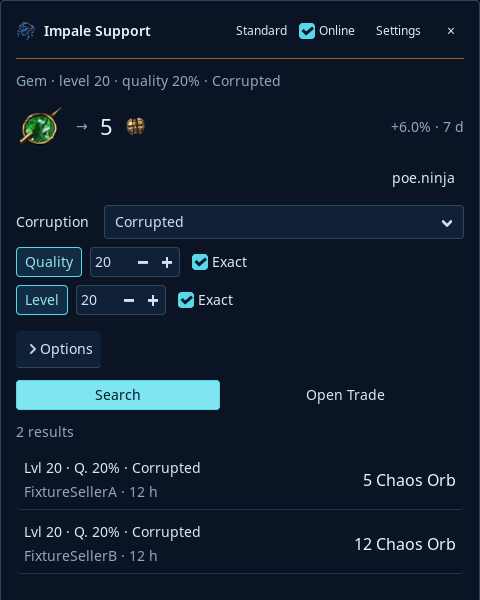
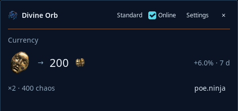
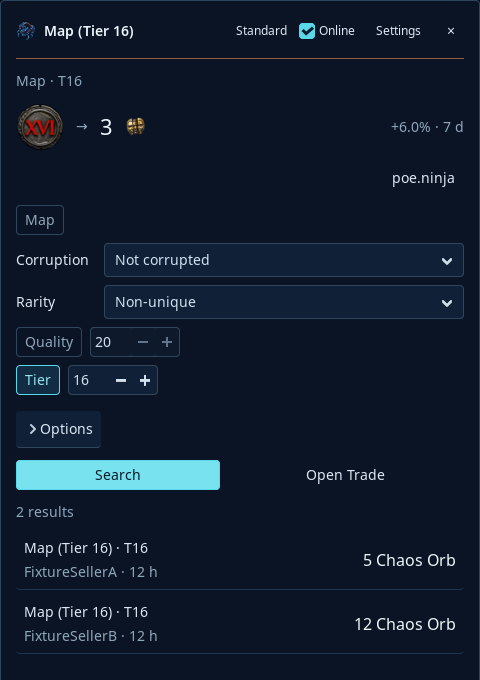
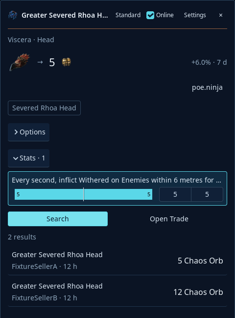
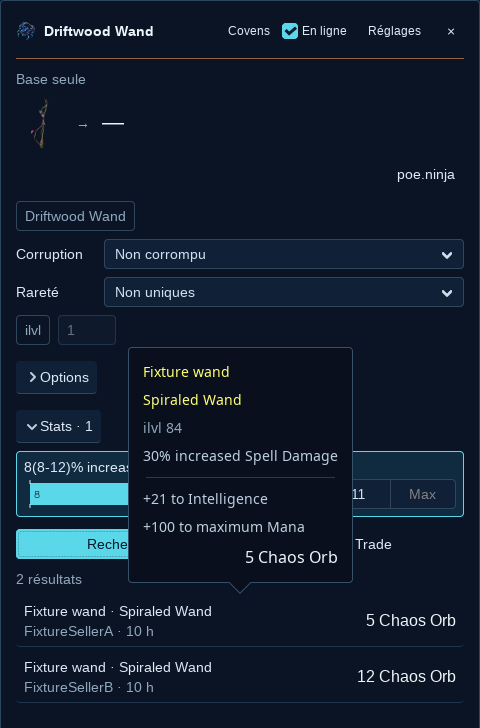

# Awakened Crab Trade

A native Path of Exile 1 price checker for Linux and Windows, inspired by
Awakened PoE Trade.

**[Latest stable release](https://github.com/Shoukshai/awakened-crab-trade/releases/latest)** | **[Standard + OCR preview](https://github.com/Shoukshai/awakened-crab-trade/releases/tag/v0.36.2)**

- Select item modifiers and adjust integer Min/Max filters.
- Search Trade offers and hover over a result to see its full mods and price.
- Check poe.ninja prices for currency, gems, uniques, maps and Viscera.
- Use a full-height overlay beside the inventory, with automatic league selection.
- Ten live-switchable styles, including light themes, tabs and a split view.
- Separate standard and cloud OCR executables, with automatic tooltip detection.

## Screenshots

[Preview all ten native styles (0.33.0)](docs/screenshots/styles/overview.webp).

English demo views from version 0.32.0. Click for full panels. Offers and prices are test data.

| Gem | Rare | Unique | Currency |
| --- | --- | --- | --- |
|  |  |  |  |

| Map | Viscera | Offer hover |
| --- | --- | --- |
|  |  |  |

## Usage

On Windows, use the standard portable EXE for local PoE. Hover over an item and press
`Ctrl+Alt+D` to open the interactive checker. `Ctrl+D` opens a passive view.
Select filters, then click **Search**. Opening the panel never starts a Trade search.
Press `Esc` or click outside the panel to close it.

Choose **English** or **Francais** in Settings, then Save. Game item and mod names
remain in English. Existing preferences are imported automatically.
Choose **Style** in Settings to preview a theme; Save keeps it and Cancel restores
the previous style. Filters and displayed offers survive a style change.

For cloud gaming, use the separate **OCR** portable EXE (experimental).
Hold Alt until the advanced tooltip appears, then press Ctrl+D. The tooltip area
is detected automatically. English game text is required; review the recognized
values before searching. Both executables have independent settings and caches,
and scope shortcuts to their own target windows. See [Windows editions](rust/docs/windows.md).

To test OCR with local PoE on Windows, open the OCR edition's **Settings > Capture**,
enable **Test on local PoE (Ctrl+Alt+O)**, then Save. Hover an item, hold Alt for its
advanced details and press `Ctrl+Alt+O`. The standard edition keeps its usual
clipboard shortcuts. Disable the option to return to the configured cloud client.

## OCR requirements (experimental)

Windows 10 1903+ or Windows 11, x64. Recognition runs locally through Rust and
native ONNX Runtime, with the small English PP-OCRv5 model included. No Python,
recognition server or dedicated GPU is required.

Provisional test target: an i3-8300-class quad-core CPU and 8 GB system RAM, with
memory available alongside the cloud client. This is not a validated minimum;
Boosteroid tests on that PC are still needed. [Measurements and test command](rust/docs/ocr-benchmark.md).

Linux currently targets River/Wayland with PoE running through XWayland.
Build and platform details: [native app](rust/README.md),
[Windows portable](rust/docs/windows-portable.md).

Explore ten interactive [UI style prototypes](docs/ui-prototypes/README.md),
including a side-by-side comparison. They run locally in a browser.

## Credits

Based on [Awakened PoE Trade](https://github.com/SnosMe/awakened-poe-trade).
Original [MIT license](LICENSE) retained. Market data comes from GGG Trade and
poe.ninja; item references include PoEDB. Project icon supplied by Shoukshai.

## TODO

- [ ] Validate cloud OCR with Boosteroid on Windows 10/11.
- [ ] Automatic updates once the repository is public.
- [ ] Improve the UI to replace the "AI slop" look, based on feedback from friends.
