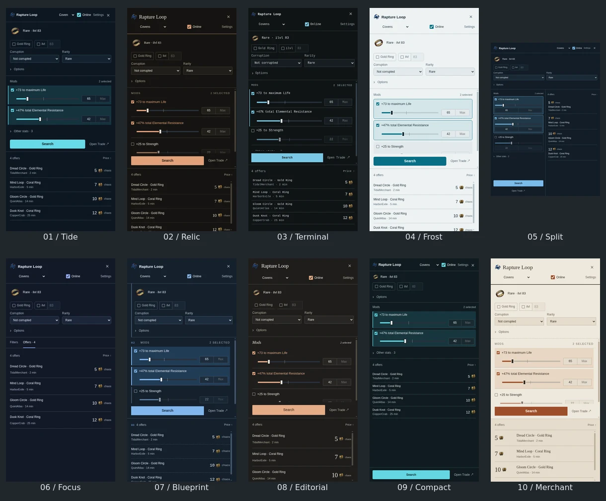

# Crab Trade UI style lab

Ten interactive HTML/CSS/JS prototypes. Open `index.html` in a browser, choose a
style, or select two for a side-by-side comparison. No installation is needed.
The gallery and individual prototypes work from local files, without internet.



For a local HTTP preview, run from this folder:

```sh
python3 -m http.server 8765 --bind 127.0.0.1
```

Open `http://127.0.0.1:8765/`. Stop the server with Ctrl+C.

| # | Style | Direction |
| --- | --- | --- |
| 01 | [Tide](prototype.html?style=tide) | Flat navy/cyan, progressive stat disclosure. |
| 02 | [Relic](prototype.html?style=relic) | PoE tooltip typography, ink and copper. |
| 03 | [Terminal](prototype.html?style=terminal) | Dense monospace, fixed numeric columns. |
| 04 | [Frost](prototype.html?style=frost) | Opaque light blue, strong text contrast. |
| 05 | [Split](prototype.html?style=split) | Independent filters and offers columns, 640 px. |
| 06 | [Focus](prototype.html?style=focus) | Filters/results tabs, one task at a time. |
| 07 | [Blueprint](prototype.html?style=blueprint) | Squared inspector, numbered sections. |
| 08 | [Editorial](prototype.html?style=editorial) | Open rows, serif titles, generous spacing. |
| 09 | [Compact](prototype.html?style=compact) | Narrow 360 px panel, fixed bottom action. |
| 10 | [Merchant](prototype.html?style=merchant) | Warm paper, price-first market ledger. |

Start by comparing Tide, Focus and Split. They explore three useful ways of
dividing attention between filter editing and market offers. The other studies
explore typography, contrast, density and the relationship to the game.

## What works

- Whole-row modifier toggles; integer sliders with joined Min/Max fields.
- Same-base and minimum-ilvl toggles, both off initially.
- Online, rarity, corruption, currency and Mirrored filters.
- Manual Search only, immediate feedback, sorted offers, stale-result clearing.
- Full-row hover and keyboard-focus previews with the offered item's stats.
- Outside click, Escape, and Ctrl+Alt+D to reopen without searching.
- French/English settings and density changes, with Save/Cancel.
- Eight item cases, including currency quotes and influenced modifiers.
- Two interactive comparison panels with shared item/language controls.

Tab navigates controls, Space toggles buttons, arrow keys adjust sliders, and
Enter searches from a value field. Closed dropdowns do not consume wheel input.
The hover preview stays inside the viewport and does not cover its offer row.

All offers and quotes are fixtures. Search is a local 180 ms simulation; filters
really change the simulated results. Trade and poe.ninja links show a demo
notice. The prototypes never access the game, clipboard, Trade or poe.ninja.
They do not change the native application's UI.

## Design sources

These are design hypotheses to compare, not usability-test results.

- [Fitts's Law](https://lawsofux.com/fittss-law/): large mod targets and nearby inputs.
- [Hick's Law](https://lawsofux.com/hicks-law/): secondary options behind disclosure.
- [Law of Proximity](https://lawsofux.com/law-of-proximity/): keep a mod and its bounds together.
- [Jakob's Law](https://lawsofux.com/jakobs-law/): preserve familiar PoE checker conventions.
- [Doherty Threshold](https://lawsofux.com/doherty-threshold/): immediate local feedback.
- [Von Restorff Effect](https://lawsofux.com/von-restorff-effect/): reserve the accent for Search and selection; also use check marks.

No framework, CDN, external font, gradients or decorative emoji. Layouts use a
4/8/12/16 px spacing scale. Tabular numerals and stable font weights keep values
aligned. Split collapses to one column in narrow viewports.

`data.js` contains the ten concepts, demo items and translations. `app.js` owns
the shared interactions. `styles.css` defines each visual system; `lab.css` and
`lab.js` handle the gallery and comparison. Artwork is copied unchanged from
the project's existing assets; see `assets/sources.json`. Item/currency artwork
is copyright Grinding Gear Games. The crab icon was supplied by Shoukshai.
