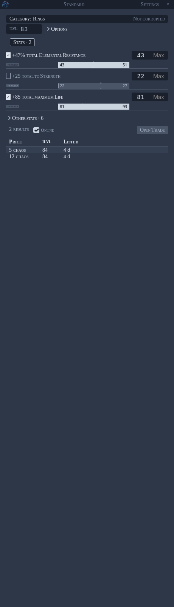
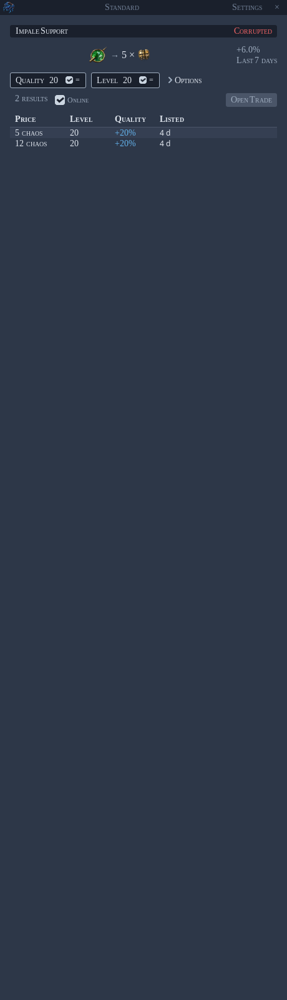
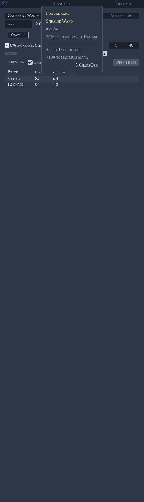

# Awakened Classic

Select Settings > Style > Awakened Classic. Preview, Save and Cancel work as with
other styles. Existing profiles keep their selected theme.

English native previews (synthetic items, quotes and offers):

| Rare | Gem | Offer hover |
| --- | --- | --- |
|  |  |  |

This eleventh native theme adapts Awakened PoE Trade's familiar price-checker
hierarchy: a 460 px full-height panel, dark league bar, separate item-name strip,
slate palette and small capitals. The item/category and corruption strip is
clickable. Compact filter chips combine toggles and editable integer values;
advanced options expand below them. Modifier rows put min/max on the right and
a 200 px range slider with endpoint values underneath.

The quote uses 32 px artwork. The results toolbar holds Online and Open Trade,
followed by aligned Price, Level, Quality and Listed columns as applicable to the
item. A completed search replaces the Search row; editing filters restores it.
The whole offer row still shows the full item on hover.
A cooldown or failed request keeps Search visible for a manual retry. Waiting
does not send another request automatically.
The Style dropdown opens below its field so the last selection does not clip
the menu above the screen on Windows.
The same filter widgets and values are reparented when the style changes; switching
styles does not start a Trade request or reset the current item or results.
OCR, explicit Search, outside-click closing and offer previews keep their behavior.

Reference: SnosMe/awakened-poe-trade, MIT, commit
`2498730beecc1a46d39214ac437ffbe9f5f542d8`. Palette and layout were checked against
[PriceCheckWindow.vue](https://github.com/SnosMe/awakened-poe-trade/blob/2498730beecc1a46d39214ac437ffbe9f5f542d8/renderer/src/web/price-check/PriceCheckWindow.vue),
App.vue, AppTitlebar.vue, FiltersBlock.vue, FilterModifier.vue, FilterName.vue,
FilterBtnNumeric.vue, StatRollSlider.vue, PriceTrend.vue, TradeListing.vue and
tailwind.config.js. The 0.36.10 pass compares the native rare and gem panels
against these component dimensions, colors and grouping, including repeated
copies, inline editing, advanced menus and all eleven style transitions.
The upstream MIT notice remains in the project's LICENSE.

This is a native GTK implementation, not the original Electron renderer;
platform font metrics and controls can differ. Fontin SmallCaps or Fontin is used
if already installed, with Georgia/Liberation Serif as a fallback. Font files are
not bundled: the foundry lists app embedding/distribution under
[extended licensing](https://www.exljbris.com/extended_license.html).
